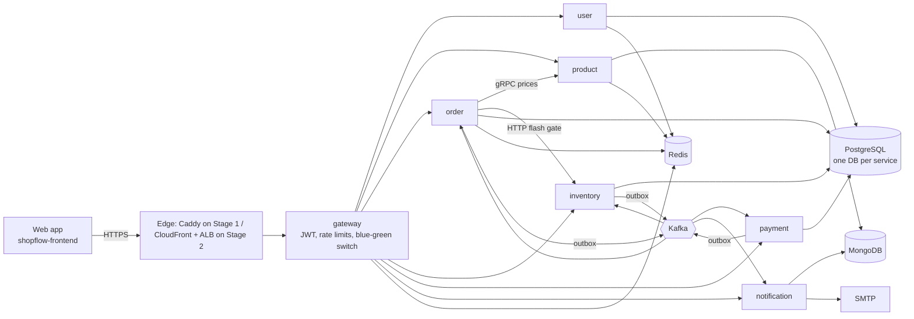

# ShopFlow

An e-commerce backend built as **7 NestJS microservices** in one monorepo: REST at the edge, **gRPC** between services, **Kafka** events with a transactional outbox, a **choreography saga** for checkout, and **Terraform + GitHub Actions** deploys to **AWS**.

**Web app:** [shopflow-frontend](https://github.com/niravparmar197/shopflow-frontend), React micro frontends (a shell + catalog, cart and checkout remotes, joined at runtime with Module Federation) on top of this API. See [Web app](#web-app-micro-frontends).

> **Status:** F0–F11 done. Live on AWS (Stage 1, on demand) with CI/CD, Trivy-gated images, health-checked deploys and automatic rollback. The web app covers browse → cart → order → pay → tracking.



**Highlights** (each one has a section below):

| Area | What is in it |
|---|---|
| Correctness | Idempotency keys, transactional outbox, idempotent consumers (`processed_events`), retry topics + DLQ, saga compensation, advisory/row locks, Redis Lua flash-sale gate |
| Resilience | Circuit breaker + retry + timeout per provider, bulkhead with load shedding, sliding-window rate limits, graceful shutdown |
| Observability | OpenTelemetry traces across HTTP, gRPC, Kafka and BullMQ; Prometheus RED + business metrics; Grafana as code; alerts → email; CQRS read model |
| Delivery | One multi-stage non-root image for all services; CI with integration tests; Trivy gate on images and IaC; deploy with health check + rollback; blue-green for payment |
| AWS | Stage 1: one EC2 + Compose + auto-HTTPS. Stage 2: CloudFront → ALB → ECS Fargate, RDS, ElastiCache, S3, CloudWatch alarms (81 Terraform resources) |

## Services

| Service        | Path                | Default port | Responsibility                                    |
| -------------- | ------------------- | ------------ | ------------------------------------------------- |
| `gateway`      | `apps/gateway`      | 3000         | Public HTTP entry point; routes to other services |
| `user`         | `apps/user`         | 3001         | Accounts, authentication, profiles                |
| `product`      | `apps/product`      | 3002         | Product catalog                                   |
| `inventory`    | `apps/inventory`    | 3005         | Stock levels and reservations                     |
| `order`        | `apps/order`        | 3003         | Order creation and lifecycle                      |
| `payment`      | `apps/payment`      | 3004         | Payment processing                                |
| `notification` | `apps/notification` | 3006         | Email / SMS / push notifications                  |

`gateway` is the default project, so Nest CLI commands without a project name target it.

## Shared libraries

Imported via TypeScript path aliases (see `tsconfig.json`).

| Library      | Alias             | Purpose                                                      |
| ------------ | ----------------- | ------------------------------------------------------------ |
| `common`     | `@app/common`     | Shared utilities, DTOs, guards, filters                      |
| `events`     | `@app/events`     | Event names and payload contracts                            |
| `kafka`      | `@app/kafka`      | Kafka client/producer/consumer wiring                        |
| `proto`      | `@app/proto`      | gRPC protobuf definitions                                    |
| `resilience` | `@app/resilience` | Retry + circuit breaker + timeout for calls to other systems |
| `scheduler`  | `@app/scheduler`  | Redis lock + LeaderJob base for scheduled jobs on many pods  |
| `observability` | `@app/observability` | OpenTelemetry tracing setup + Prometheus metrics helpers |

## Project structure

```
shopflow/
├── apps/                 # the 7 services (each: src/, test/, .env.example)
│   ├── gateway/  user/  product/  order/  inventory/  payment/  notification/
├── libs/                 # shared code (path aliases @app/*)
│   ├── common/  events/  kafka/  proto/  resilience/  scheduler/  observability/
├── infra/
│   ├── docker-compose.yml        # local infrastructure (Postgres, Mongo, Redis, Kafka, MinIO, Jaeger, ...)
│   ├── docker-compose.prod.yml   # the 7 services as containers
│   ├── terraform/                # AWS: bootstrap, stage1, stage2
│   └── grafana/ prometheus/ alertmanager/ postgres/
├── deploy/stage1/        # the Stage 1 bundle (compose, Caddy, deploy.sh)
├── docs/                 # ADRs, runbook, deploy guide, exported OpenAPI specs
├── scripts/              # dev and ops scripts (see Scripts)
├── load-tests/           # k6 flash-sale test
├── Dockerfile            # one multi-stage image for every service
└── nest-cli.json         # monorepo project definitions
```

## Getting started

### Prerequisites

- Node.js 22.12+
- npm
- Docker (local infrastructure and integration tests)

### Install

```bash
npm install
```

### Run the whole stack locally (PowerShell)

**1. Infrastructure** (Postgres 5434, Mongo 27017, Redis 6380, Kafka 9092, MinIO 9002, Jaeger 16686, Mailpit 8025, Grafana 3010):

```powershell
docker compose -f infra/docker-compose.yml up -d
```

**2. Config and keys** (once):

```powershell
foreach ($a in 'gateway','user','product','order','inventory','payment','notification') {
  Copy-Item "apps/$a/.env.example" "apps/$a/.env"
}
node scripts/generate-jwt-keys.js        # writes keys/ (git-ignored)
```

Then edit the `.env` files:
- `DATABASE_URL`: replace `USER:PASSWORD` with `shop:shop` (user, order, inventory, payment).
- `apps/payment/.env`: set `FAKE_WEBHOOK_SECRET` to any long random string. The fake payment provider refuses to start without it.

**3. Database, topics, sample data:**

```powershell
npm run migration:run:user; npm run migration:run:order; npm run migration:run:payment; npm run migration:run:inventory
npm run kafka:topics
npm run seed:product                      # 60 sample products (catalog only)
```

**4. Start the 7 services** (each in its own window, with watch mode):

```powershell
foreach ($a in 'user','product','order','inventory','payment','notification','gateway') {
  Start-Process powershell -ArgumentList '-NoExit', '-Command', "npx nest start $a --watch"
}
```

The gateway is on **http://localhost:3000**, and the API docs are at **http://localhost:3000/docs**.

**5. An admin user and stock** (once). Products from the seed have **no stock**, and an order for an item without stock is cancelled (`OUT_OF_STOCK`) before payment.

1. Sign up (in the web app or with `POST /v1/auth/signup`).
2. Make yourself admin, then log in again (the role is in the token):
   ```powershell
   docker exec -it shopflow-postgres psql -U shop -d users_db -c "UPDATE users SET role='admin' WHERE email='you@example.com';"
   ```
3. Give every product stock:
   ```powershell
   .\scripts\seed-stock.ps1 -Email you@example.com -Password YourPassword1
   ```

**6. The web app:** clone [shopflow-frontend](https://github.com/niravparmar197/shopflow-frontend), then run `npm install` and `npm run dev`, and open **http://localhost:5000**. Its dev server sends `/v1` to the gateway on :3000.

> All 7 services as containers instead: see [Production images](#production-images-f11).

### Run one service

Pass the project name to the Nest CLI:

```bash
npx nest start gateway --watch
```

Each service listens on its default port from the table above, so several can run side by side. Override it with the `PORT` environment variable:

```bash
# bash
PORT=4001 npx nest start user --watch
```

```powershell
# PowerShell
$env:PORT=4001; npx nest start user --watch
```

### Build

```bash
npx nest build gateway        # outputs to dist/apps/gateway
node dist/apps/gateway/main
```

## Auth (F1)

```
Client → Gateway (:3000) → User service (:3001) → PostgreSQL users_db
```

- Signup / login in the User service; passwords hashed with bcrypt (12 rounds)
- Access token: JWT RS256, 15 min, sent as `Authorization: Bearer`. Only the User service holds the private key; the gateway verifies with the public key
- Refresh token: random, 7 days, in an httpOnly + `SameSite=Strict` cookie scoped to `/v1/auth`, stored only as a SHA-256 hash
- Refresh rotation with reuse detection: reusing a spent token revokes its whole family. A row lock serializes concurrent refreshes
- Gateway: JWT check, correlation id (`x-correlation-id`, logged by every service), Redis rate limits (100/min global, 5/min login), 5 s timeouts, strips client-sent `x-user-*` headers
- Errors everywhere use one shape: `{ code, message, details?, correlationId }`

| Endpoint                | Auth         | Notes                                   |
| ----------------------- | ------------ | --------------------------------------- |
| `POST /v1/auth/signup`  | none         | `{ email, password, name }`             |
| `POST /v1/auth/login`   | none         | returns `accessToken`, sets `rt` cookie |
| `POST /v1/auth/refresh` | `rt` cookie  | rotates the cookie, new `accessToken`   |
| `POST /v1/auth/logout`  | `rt` cookie  | revokes the token family                |
| `GET /v1/users/me`      | Bearer token | current user                            |

## Products (F2)

```
Client → Gateway ──gRPC──▶ Product service ──▶ Redis (cache) ──▶ MongoDB
Admin  → presigned POST ──▶ S3 / MinIO  (server never handles the file)
```

- Product service: MongoDB catalog (flexible attributes), compound + text indexes
- Cursor pagination (stable, fast at any depth), max 50 per page
- Gateway → Product over **gRPC** (proto contract in `libs/proto`), 2 s deadline, error mapping
- Redis cache-aside: single-flight, TTL jitter, negative cache, versioned list keys, fail-open
- Optimistic locking with `version` (409 on stale update)
- Admin create / update / image confirm return the **same product shape as the public API** (`id`, image URLs), documented with response DTOs in Swagger
- Images: S3 presigned POST (5 MB, type locked) → `tmp/` → confirm → `products/`; `tmp/` auto-deleted after 1 day
- Tests: unit (cache, images with S3 mocked) + integration with real MongoDB + Redis via Testcontainers (`npm run test:e2e:product`), covering pagination, roles, 409s, cache invalidation, concurrent edits and the gRPC contract

## Cart + coupons (F3)

```
Client → Gateway (JWT) → Order service ──▶ Redis: cart:{userId} (7-day TTL)
                              ├──gRPC──▶ Product: live prices (1 s deadline)
                              └────────▶ PostgreSQL: coupons
```

- Cart in a Redis hash `cart:{userId}` (productId → qty). Prices are never stored; they always come live from the product service
- Limits (20 different items, qty ≤ 10) enforced atomically with Redis Lua scripts, so parallel adds can't overshoot
- Product service down → the cart still loads without prices (`pricingAvailable: false`); adding returns 503
- Coupons in PostgreSQL. Rules are a **Chain of Responsibility** (Active → Dates → Usage → MinCart → Category → FirstOrder); discounts are a **Strategy** (Percent with cap / Flat)
- The coupon is re-checked on every cart read; if the cart stops qualifying it shows `applied: false` + reason instead of failing
- Tests: integration with real PostgreSQL + Redis via Testcontainers, product service faked (`npm run test:e2e:order`), incl. 25 parallel adds → exactly 20 items

| Endpoint                              | Auth  | Notes                                        |
| ------------------------------------- | ----- | -------------------------------------------- |
| `GET /v1/cart`                        | user  | items, live prices, coupon, totals           |
| `POST /v1/cart/items`                 | user  | `{ productId, qty }`, adds to existing qty   |
| `PATCH /v1/cart/items/:productId`     | user  | `{ qty }`                                    |
| `DELETE /v1/cart/items/:productId`    | user  |                                              |
| `POST /v1/cart/coupon`                | user  | `{ code }`, 400 with the reason if not valid |
| `DELETE /v1/cart/coupon`              | user  |                                              |
| `POST /v1/coupons`, `GET /v1/coupons` | admin | create / list coupons                        |

## Orders (F4)

```
POST /v1/orders ─▶ Redis checkout lock (per user)
                   ├─ cart (Redis) + live prices (gRPC)       outside the transaction
                   ├─ BEGIN
                   │    advisory lock (per user) → coupon rules → used_count + 1 (atomic)
                   │    order + item snapshots → outbox "order.created" → idempotency result
                   │  COMMIT
                   └─ clear the cart
```

- **State pattern** for order status (`PENDING → CONFIRMED → PAID → SHIPPED → DELIVERED`, plus `CANCELLED` / `FAILED`); any other move is `409 INVALID_ORDER_TRANSITION`
- **Idempotency-Key** on `POST /v1/orders`: same key + same body replays the saved response (`Idempotent-Replayed: true`); the result is saved in the same transaction as the order, so a crashed request can be taken over safely after 2 min
- **Transactional outbox**: `order.created` is written in the same commit as the order, ready for the Kafka publisher (F5)
- Coupon use is one conditional `UPDATE` (no read-then-write race); failures roll back everything, including the coupon use
- Items keep a snapshot of name and price; later product changes don't alter past orders
- Tests (`npm run test:e2e:order`): replay, 5 parallel requests with one key, last coupon use raced by 2 users, same user with 2 keys, rollback, product service down, IDOR, cursor pagination

| Endpoint                      | Auth | Notes                                                                                   |
| ----------------------------- | ---- | --------------------------------------------------------------------------------------- |
| `POST /v1/orders`             | user | `Idempotency-Key` header (8–100 chars); body `{ expectedTotalPaise? }`; 10/min per user |
| `GET /v1/orders?limit&cursor` | user | newest first, cursor pagination (max 50)                                                |
| `GET /v1/orders/:id`          | user | only your own orders, otherwise 404                                                     |

| Error code                                             | HTTP | Meaning                                                                    |
| ------------------------------------------------------ | ---- | -------------------------------------------------------------------------- |
| `IDEMPOTENCY_KEY_REQUIRED` / `IDEMPOTENCY_KEY_INVALID` | 400  | header missing or badly formed                                             |
| `CART_EMPTY`                                           | 422  | nothing to order                                                           |
| `CART_ITEM_UNAVAILABLE`                                | 409  | a product was removed or deactivated; `details.productIds`                 |
| `PRICE_CHANGED`                                        | 409  | `expectedTotalPaise` is out of date; `details.totalPaise` is the new total |
| `COUPON_NOT_APPLICABLE` / `COUPON_EXHAUSTED`           | 409  | coupon failed a rule / its last use was just taken                         |
| `IDEMPOTENCY_KEY_REUSED`                               | 422  | same key, different body                                                   |
| `IDEMPOTENCY_IN_PROGRESS` / `CHECKOUT_IN_PROGRESS`     | 409  | the first request (or another checkout) is still running; retry soon       |
| `SERVICE_UNAVAILABLE`                                  | 503  | product service down; nothing was saved                                    |
| `TOO_MANY_REQUESTS`                                    | 429  | more than 10 order requests a minute                                       |

## Events (F5)

```
order.created ─▶ Inventory ─┬─▶ stock.reserved ─▶ Order: PENDING → CONFIRMED (+ order.confirmed)
                            └─▶ stock.failed   ─▶ Order: PENDING → FAILED    (+ order.failed)
```

| Topic                           | Key          | Events                                                                              |
| ------------------------------- | ------------ | ----------------------------------------------------------------------------------- |
| `order-events`                  | orderId      | `order.created`, `order.confirmed`, `order.failed`, `order.paid`, `order.cancelled` |
| `inventory-events`              | orderId      | `stock.reserved`, `stock.failed`                                                    |
| `payment-events`                | orderId      | `payment.succeeded`, `payment.failed`, `payment.refunded`                           |
| `<group>.retry` / `<group>.dlq` | original key | failed messages (headers `x-error`, `x-attempt`, `x-original-topic`)                |

- **Outbox relay** (`libs/kafka`): at-least-once delivery from the outbox table to Kafka, keyed by aggregate id so one order's events stay in order
- **BaseConsumer** (template method): every consumer records the `eventId` in `processed_events` in the **same transaction** as its change, so duplicates have no effect (exactly-once effect)
- **Reserve stock**: one conditional `UPDATE … WHERE available >= qty` per product (no oversell), rows locked in sorted order (no deadlock), savepoint for all-or-nothing
- **Failures**: poison (bad JSON / schema / version) → `<group>.dlq` at once; other errors → `<group>.retry` after 1 s, 5 s, 15 s, then the DLQ; the partition never blocks
- Tests with a real Kafka (`npm run test:e2e:inventory`, and the saga suite in `npm run test:e2e:order`): same event 3×, 100 buyers for 10 items, opposite lock order, poison → DLQ, DB error → retry → success, late events ignored by the state machine
- Decision record: [ADR 0001 — choreography saga](docs/adr/0001-choreography-saga.md)

### DLQ runbook

1. Kafka UI → topic `<group>.dlq` → read the `x-error` and `x-dlq-reason` headers.
2. Fix the cause (bug, data, config).
3. `npm run dlq:replay -- <group>` sends the messages back to their original topic (`--include-poison` once a code fix can handle them).

## Payments (F6)

```
PENDING ──webhook success──► SUCCEEDED ──order.cancelled──► REFUND_PENDING ──► REFUNDED
   │                                                              ▲
   └──timeout (sweeper)──► EXPIRED ──late webhook success─────────┘
```

- **Providers**: `PAYMENT_PROVIDER=fake | razorpay | stripe`. One `PaymentProvider` interface (Strategy), one adapter per provider (Adapter), picked by `PaymentProviderFactory`. `fake` is for dev and tests only and is refused in production.
- **Checkout**: `POST /v1/payments/:orderId/checkout` returns what the frontend needs to open the provider's checkout. Calling it again resumes the same provider order. Every provider call goes through `@app/resilience`: 2 s timeout per attempt, 2 retries with backoff + jitter (temporary errors only), and a circuit breaker per provider (≥ 50 % of ≥ 5 calls fail → fail fast for 30 s). The gateway allows 10 s for `/v1/payments`, above that ~6.6 s worst case.
- **Webhooks**: `POST /v1/payments/webhooks/:provider`, no JWT. HMAC over the raw body (wrong → 401); deduplicated by `(provider, event id)` in the same transaction as the change; no per-IP rate limit. A non-2xx (e.g. 503 for an unknown provider order) makes the provider send it again.
- **A declined card is not a failed payment**: the user can try again until `expires_at` (`PAYMENT_TTL_MINUTES`, 15). Only the expiry is final.
- **Sweeper** (`PAYMENT_SWEEP_MS`, 30 s, every pod): `FOR UPDATE SKIP LOCKED` expires due payments (→ `payment.failed`) and retries pending refunds. Webhook and sweeper both lock the row first, so a payment ends in exactly one final state; a success that arrives after the expiry is refunded automatically.
- **Refunds**: a 2-minute lease (`refund_attempted_at`), the provider call outside any transaction, then a conditional `REFUND_PENDING → REFUNDED` (+ `payment.refunded`). The payment id is the provider's idempotency key.
- Dev only: `POST /v1/payments/dev/fake-mode` (`ok` / `fail` / `slow` / `flaky`), `GET /v1/payments/dev/circuits`, and `POST /v1/payments/dev/fake-pay/:orderId` `{ "outcome": "succeeded" | "failed" }`, the web app's **Pay / Decline** buttons. It signs a fake webhook on the server (the browser never has the secret) and runs it through the normal webhook path.
- The payment row is created when the order is **confirmed** (stock reserved), a few seconds after it is placed. Until then checkout answers `404 PAYMENT_NOT_FOUND`, so the client retries. An order cancelled before that (e.g. `OUT_OF_STOCK`) never gets a payment.
- Tests (`npm run test:e2e:payment`): signatures, dedupe, declined attempts, expiry, late success → refund, refund lease, **webhook vs timeout racing 20×** (always one outcome, one refund per lost race), circuit breaker opening, timeouts, compensation.
- Decision record: [ADR 0002: payment providers, webhooks, auto-refund](docs/adr/0002-payment-providers-and-refunds.md)

### Saga end to end

**Order owns the order status**: Inventory and Payment react to `order.*` events, never to each other.

| Event                        | Order     | Inventory                       | Payment                            |
| ---------------------------- | --------- | ------------------------------- | ---------------------------------- |
| `order.created`              | PENDING   | reserve                         | –                                  |
| `stock.reserved`             | CONFIRMED | –                               | create payment (`order.confirmed`) |
| `payment.succeeded`          | PAID      | commit (via `order.paid`)       | –                                  |
| `payment.failed`             | CANCELLED | release (via `order.cancelled`) | –                                  |
| `order.cancelled` after paid | –         | – (already sold)                | refund                             |

Compensation is idempotent twice over: `processed_events` drops redelivered events, and only `RESERVED` reservations can be committed or released, so even a second, different cancel event changes nothing.

## Notifications (F7)

```
order-/payment-events ─▶ NotificationsConsumer ─┬─ order.created ─▶ Mongo orders_view (projection)
                                                └─ other events ─▶ Command ─▶ BullMQ "notifications"
BullMQ ─▶ worker (5 at once, ≤ 10/s) ─▶ handler ─▶ EmailSender (SMTP → Mailpit; SES later)
                                                 └─▶ Mongo notification_logs: QUEUED → SENT / FAILED
```

| Event              | Email                          |
| ------------------ | ------------------------------ |
| `order.paid`       | Order confirmed                |
| `order.cancelled`  | Order cancelled (+ the reason) |
| `order.failed`     | We could not place the order   |
| `payment.refunded` | Your refund is on the way      |

- **Local projection**: notification never calls the order or user service. The buyer's email is snapshotted on the order at checkout and sent in `order.created` (an optional field, so still version 1).
- **Command pattern**: the planner turns an event into commands (`SendEmailCommand`); the worker runs the handler for the job name. A new channel (SMS) = one command + one handler.
- **Why a queue between Kafka and SMTP**: Kafka is acknowledged fast, a slow mail server can't stall a partition, and each email retries on its own schedule.
- **Dedupe**: BullMQ `jobId = <eventId>-<channel>-<template>` + a unique log key. The job is queued _before_ the log is written, so a crash in between loses nothing.
- **Retries**: 4 attempts with exponential backoff (2 s, 4 s, 8 s; `NOTIFY_BACKOFF_MS`). SMTP 5xx or an unknown template → `FAILED` at once. Delivery is at least once: the worker skips jobs already `SENT`, but SMTP has no idempotency key.
- **No replay on deploy**: the consumer group starts from now (`fromBeginning = false`), so a new deploy doesn't email customers about old orders.
- **Ops**: Mailpit at http://localhost:8025, Bull Board at http://localhost:3006/v1/queues (dev only: it can retry and delete jobs), and `GET /v1/notifications?orderId=` (admin) shows what was sent.
- Tests (`npm run test:e2e:notification`): projection, one email per event (×3 duplicates), every template, HTML escaping, SMTP down → 4 attempts → `FAILED` → retry → `SENT`, flaky → `SENT`, SMTP 550 → `FAILED` after 1 attempt, no email address, unknown order → DLQ, admin-only log endpoint.

## Scheduled jobs (F8)

| Job                  | Service   | When (UTC)          | What                                                                                               |
| -------------------- | --------- | ------------------- | -------------------------------------------------------------------------------------------------- |
| `order-expiry`       | order     | every minute at :00 | PENDING > 10 min → CANCELLED (`STOCK_TIMEOUT`); CONFIRMED > 30 min → CANCELLED (`PAYMENT_TIMEOUT`) |
| `reservation-expiry` | inventory | every minute at :30 | holds past their 60 min expiry → released (+ `stock.released`, `HOLD_EXPIRED`)                     |
| `order-housekeeping` | order     | hourly at :15       | deletes outbox rows published > 7 days ago, `processed_events` > 14 days, idempotency keys > 1 day |
| payment sweeper      | payment   | every 30 s          | expires PENDING payments, retries refunds (every pod runs it; `SKIP LOCKED` splits the rows)       |

An expired order needs nothing else: its `order.cancelled` makes inventory release the stock, payment close or refund, and notification send the email.

**Safe with many pods** (`libs/scheduler`, `LeaderJob`):

- **Efficiency: a Redis lock** per job, so one pod runs each tick. `SET NX PX` (atomic, with a TTL, so a crashed holder can't block it forever), an owner token, and Lua compare-and-renew / compare-and-release (a slow pod can't free someone else's lock). A heartbeat renews it at TTL/3; if renewal fails, `ctx.lost` tells the job to stop after the current batch. After a run the lock is kept until 1 s before the next tick: pods' timers fire a few ms apart, and a freed lock would let a late pod run the same tick again. A `running` flag stops overlap inside one pod.
- **Correctness: the database.** Every change is made in small batches with `FOR UPDATE SKIP LOCKED` and the order state machine, so even two pods running at once (lock lost to a GC pause, a network split) change each row once.
- Crons have 6 fields (seconds first) and run in UTC. `JOBS_ENABLED=false` turns them off (tests call `tick()` themselves); `*_CRON` env vars override the schedules.

**Timing contract**: the timers must nest, or a service acts on stale state:

```
payment TTL (15 min)  <  order CONFIRMED timeout (30 min)    payment decides; order is the backstop
order max life (10 + 30 = 40 min)  <  reservation hold (60 min)    stock is never released for an order that can still be paid
```

If the hold ever ends first anyway, paying that order logs `ALERT: order … is PAID but has no RESERVED reservation`.

Tests (`npm run test:e2e:order`, `npm run test:e2e:inventory`): **3 copies of the order service** run the expiry job together and cancel each of 300 stale orders exactly once; the same **without the lock** (DB fencing alone); only stale orders are touched; one of 3 simultaneous ticks runs; overlap in one pod; renewal on a job longer than the TTL; takeover after a crashed holder; a stolen lock stops the job without deleting the new owner's lock; two racing hold-expiry runs release once.

Decision record: [ADR 0003: Redis lock for efficiency, database for correctness](docs/adr/0003-distributed-locks.md)

## Flash sale (F9)

```
1,000 clicks → gateway: per-user sliding-window limit (Redis ZSET + Lua) ──► 429 RATE_LIMITED + Retry-After
             → order: bulkhead (50 in flight, 200 waiting) ──────────────────► 429 SERVER_BUSY (load shedding)
             → inventory: Redis Lua gate (stock + 1 per user) ───────────────► 409 SOLD_OUT in ~1 ms
             → winners only: pricing, order, Kafka → DB atomic reserve (the FINAL judge, unchanged since F5)
```

- **Rate limit** (gateway): exact per-user limits on writes: orders 5/10 s, cart writes 30/10 s, payment POSTs 5/10 s; keyed by the verified JWT subject; Redis's clock; fails open. The per-IP global limit (`RATE_LIMIT_GLOBAL_PER_MIN`, 100) stays for everything else.
- **Gate** (inventory owns it, `inv:flash:*`): admin `POST /v1/inventory/flash-sales` starts a sale (≤ stock; no restart while running). Order asks `/v1/internal/flash-sales/acquire` (service token; never routed by the gateway) **before pricing**, so a loser costs no gRPC call and no transaction. Tokens go back after commit when the order is cancelled, when the DB reserve fails, or when checkout fails after the gate. Release is idempotent.
- **Bulkhead** (`libs/resilience`): caps concurrent gate calls; full → 429 `SERVER_BUSY` with `Retry-After`. Circuit breaker = "is it broken?"; bulkhead = "are we sending too much?".
- **Failure directions**: the gate down → fail open (the DB still prevents overselling); a lost token return → undersell by one, never oversell.
- Tests: `npm run test:e2e:gateway` (100 concurrent hits → exactly the limit), `npm run test:e2e:inventory` (100 buyers → exactly 10 tokens, idempotent release, tokens back on cancel / DB failure, internal token).

### Load test (k6)

See [load-tests/README.md](load-tests/README.md). On one Windows laptop running every service: **the verified run confirmed exactly 10 of 1,000 buyers, every request was answered with 0 5xx, and stock never went negative in any run**; but buy p95 was ~8 s (target 800 ms), some buyers failed open past the gate when the overloaded order service let the 500 ms gate timeout expire, and same-millisecond bursts overflow Windows' listen queue. The order service is CPU-bound, mostly in Windows socket syscalls; the next measurement belongs on Linux.

### Back-of-the-envelope (estimates, not measurements)

- Redis gate: one Lua call ≈ 0.1 ms → one Redis node ≈ 50–100k gate checks/s.
- Order service: measured here ≈ 150–250 checkout attempts/s per process on Windows (~10 ms CPU each); on Linux expect several times that. 10 pods ≈ low thousands/s.
- Winners only reach Postgres: 10 orders × ~5 ms. Without the gate: 1,000 transactions + 1,000 events + 990 failure emails.
- 1M users clicking within 10 s ≈ 100k req/s → autoscaled gateway and order pods, a Redis cluster, and at that size a **virtual waiting room** (queue tokens) in front of checkout.

## Observability (F10)

| Question                                            | Tool                                                                                                                                                        |
| --------------------------------------------------- | ----------------------------------------------------------------------------------------------------------------------------------------------------------- |
| What happened to THIS order, and where was it slow? | **Traces**: OpenTelemetry → Jaeger, http://localhost:16686                                                                                                  |
| Is the system healthy right now?                    | **Metrics**: `/metrics` on every service → Prometheus (http://localhost:9091) → Grafana (http://localhost:3010, admin/admin, dashboard "ShopFlow Overview") |
| Wake me up when it breaks                           | **Alerts**: `infra/prometheus/alerts.yml` → Alertmanager (http://localhost:9093) → email (Mailpit)                                                          |

```powershell
docker compose -f infra/docker-compose.yml up -d jaeger prometheus alertmanager kafka-exporter grafana
```

**Tracing.** Each app imports `tracing.ts` on the first line of `main.ts` (auto-instrumentation patches http, express, gRPC, pg, ioredis, MongoDB and pino as they load). The outbox breaks the call chain on purpose, so the request's trace context is saved in the event (`trace` in the envelope), restored by the relay (one PRODUCER span per message, with `shopflow.outbox_wait_ms`) and passed in the Kafka headers to the consumer's CONSUMER span; BullMQ jobs carry it the same way. Retries keep the headers, so they appear in the same trace. Every span has `shopflow.order_id`: search Jaeger by that tag to find every trace of an order (checkout, webhook, timeout job). Error responses carry `traceId`; log lines carry `trace_id`. Parent-based sampling (100 % locally): the edge decides once, everyone follows.

**Metrics** (`libs/observability`):

- **RED** per route: `http_server_request_duration_seconds{method,route,status_code}`. Routes are templates (`/v1/orders/:id`), never raw URLs: every distinct label value is a new time series.
- **USE**: CPU, memory, GC, `nodejs_eventloop_lag_p99_seconds`.
- **Async health**: `kafka_messages_processed_total{group,event_type,result}` (ok / duplicate / retry / dlq), `outbox_oldest_pending_age_seconds` (age catches "Kafka down", a count doesn't), `kafka_consumergroup_lag` (kafka-exporter), `circuit_state`, `bulkhead_calls`, `queue_jobs`.
- **Business**: `shopflow_orders_placed_total`, `shopflow_order_transitions_total{to,reason}`, `shopflow_revenue_paise_total`, `shopflow_checkout_rejected_total{code}`, reservations, holds released, flash-gate answers, payments, webhooks, notifications, and the F8 invariant `shopflow_paid_without_reservation_total`. Counted after the DB commit, so a retried event counts once. Labels are small fixed sets, never ids (ids go in traces).
- `/metrics` is for the internal network only: never routed by the gateway, and blocked at the edge in production (the gateway's own `/metrics` too).

**Alerts**: service down, 5xx > 1 %, p95 > 800 ms, a message sent to a DLQ, consumer lag > 1,000, outbox stuck > 60 s, payment circuit open, paid without reservation, event loop blocked. Critical ones repeat every 30 min; resolved alerts are emailed too.

**SLIs and SLOs**

| SLI (what we measure)                           | SLO (the promise) | Error budget (30 days)        |
| ----------------------------------------------- | ----------------- | ----------------------------- |
| Checkout requests that are not 5xx              | 99.5 %            | 0.5 % ≈ 3.6 h of "all broken" |
| Checkout requests under 800 ms                  | 95 %              | 5 % may be slower             |
| Paid orders confirmed < 1 min after the webhook | 99 %              | 1 %                           |

Budget almost spent → freeze risky releases and fix reliability first; plenty left → ship faster. The alerts above are the early warnings.

**Runbook**: every alert has a first look and a usual fix in [`docs/runbook.md`](docs/runbook.md). Design notes: [ADR 0004](docs/adr/0004-observability-and-read-model.md).

**Tests** (`apps/order/test`): `tracing.e2e-spec.ts` uses an in-memory span exporter to prove that one trace survives outbox → Kafka → consumer → outbox → Kafka, with the right parent/child links. `read-model.e2e-spec.ts` checks `/metrics` (route templates, no raw ids, one `unmatched` series for junk URLs, business counters).

## My orders (CQRS read model)

`order_views` is one flat row per order, built from order-events and payment-events (consumer group `order-read-model`): status, payment status, title ("Phone + 2 more"), totals and a timeline. `GET /v1/orders?limit=&cursor=` and `GET /v1/orders/:id/tracking` read it, with no join and no call to the payment service.

- **Out of order is fine**: every event upserts; a payment event that arrives before `order.created` makes a hidden placeholder that is filled in later.
- **Never backwards**: the status moves by rank (PENDING → CONFIRMED → PAID/FAILED/CANCELLED), not by timestamp, so a late `order.confirmed` can't undo PAID. A refund is the payment's last word.
- **Read-your-writes**: orders from the last 30 s that the view hasn't caught up with come from the orders table (`syncing: true`), paged together with the view under one cursor, and never listed twice.
- **Rebuild**: `scripts/rebuild-order-views.ps1` replays the topics; `scripts/backfill-order-views.sql` covers orders older than the topic retention.

Tested in `read-model.e2e-spec.ts`: events fed out of order, cancel then late payment + refund, read-your-writes before and after projection, and someone else's order → 404.

## Web app (micro frontends)

The web shop lives in its own repo: **[shopflow-frontend](https://github.com/niravparmar197/shopflow-frontend)** (React 19, Vite, Module Federation). It is a shell plus 3 remotes, one per business area, like the services:

| Web app (remote) | Pages | Calls |
|---|---|---|
| shell | header, login, signup | `/v1/auth/*`, `/v1/users/me` |
| catalog | home, product list, detail | `GET /v1/products` (gRPC behind the gateway) |
| cart | cart page, header badge | `/v1/cart`, `/v1/cart/coupon` |
| checkout | place order, pay, my orders, tracking | `/v1/orders`, `/v1/payments` |

What the web app relies on here:
- **One origin.** The refresh cookie is `httpOnly`, `SameSite=strict`, `path=/v1/auth`, so the web app and `/v1` must share an origin: the Vite proxy in dev, Caddy/CloudFront in production. No CORS is needed.
- **Error bodies** `{ code, message, details, correlationId }`: the UI switches on `code` (`PRICE_CHANGED`, `SOLD_OUT`, `SERVER_BUSY`, ...) and shows `correlationId` as a reference.
- **Idempotency-Key + `expectedTotalPaise`** on `POST /v1/orders`: a retry or double click never makes a second order, and a price change is refused instead of charged.
- **Per-user limits on POST** (cart 30 / 10 s, orders 5 / 10 s, payments 5 / 10 s): the web app spaces its retries to stay below them.

## API docs (Swagger)

**http://localhost:3000/docs**: one Swagger UI on the gateway, with a dropdown per service (Gateway products, User & Auth, Orders & Cart, Payments, and the admin APIs).

- Each service describes itself and serves only `GET /docs/openapi.json`. The `@nestjs/swagger` CLI plugin builds the schemas from the class-validator DTOs and `/** comments */` (`*.dto.ts`, `*.entity.ts`, `*.query.ts`), so restart `start:dev` after changing one.
- The gateway fetches each spec (2 s timeout), caches it for 60 s, and serves the last good copy if a service is down; with no copy it returns `502 SPEC_UNAVAILABLE` for that spec only.
- "Try it out" goes through the real gateway: JWT checks, rate limits, the Idempotency-Key rule. Log in under **User & Auth**, paste `accessToken` into **Authorize**; it persists across specs and reloads.
- Error responses are documented with the shared `ErrorResponseDto` and the codes each endpoint can return (`@ApiError(status, 'CODE | CODE')`).
- Hidden: webhooks (providers call them with a signature), `/internal/*`, dev endpoints, health, metrics.
- `SWAGGER_ENABLED=false` turns it all off. In production `/docs` sits behind basic auth at the edge: a public map of every endpoint helps attackers.
- `npm run openapi:export` (stack running) writes `docs/openapi/*.json`; commit them so API changes show up in the PR diff.

## Production images (F11)

One `Dockerfile` for all 7 services: multi-stage (dev deps stay in the build stage), `node:22-bookworm-slim` pinned (glibc, for bcrypt), non-root `node` user, `tini` as PID 1 so `SIGTERM` reaches Node, and a `HEALTHCHECK` on `/health/live`. No secrets in the image: env comes from `infra/env/*.env`, JWT keys are mounted at `/run/keys`.

```powershell
foreach ($a in 'gateway','user','product','order','inventory','payment','notification') {
  docker build --build-arg APP=$a -t "shopflow/${a}:dev" .; if ($LASTEXITCODE) { throw $a }
}
# infra/env/*.env from the .env.example files next to them, then:
docker compose -f infra/docker-compose.yml -f infra/docker-compose.prod.yml up -d
./scripts/smoke.ps1
```

- **Migrations are a release step, not a boot step**: `node dist/main.js migrate` applies pending migrations and exits (compose runs `*-migrate` jobs before the apps). A Postgres advisory lock means only one runner works at a time, however many start. Migrations are listed in `database/migrations/index.ts` (the bundle has no files to glob); a unit test fails if a migration file is missing there.
- **Expand / contract**: the old version keeps serving during a rolling deploy, so every migration must work with both. Add a column as nullable (or with a default) first; drop or rename only one release after nothing reads the old one.
- **Graceful shutdown**: on `SIGTERM`, `/health/ready` returns 503 `SHUTTING_DOWN` at once (the load balancer drains), then Nest's shutdown hooks finish the relay batch / consumer message / job and close connections.
- Only the gateway publishes a port; services reach each other by compose name (`http://order:3000`, `product:50052`).
- Local compose runs payment with `NODE_ENV=development` and the fake provider; production refuses the fake provider.
- Known trade-off: every image carries the whole monorepo's production `node_modules`. Per-app pruning (e.g. `turbo prune`) is the next step.

## Deploy on AWS (F11)

Account notes that shaped the design (ADR 0005): the AWS "projects" Free plan allows only the
project Region (**`ap-southeast-2`**) and blocks IAM OIDC providers, so CI uses a
least-privilege IAM user that can only push to ECR and run the Stage 1 deploy.

### Pipeline

1. **CI** (every PR): lint, type check, unit + integration tests for all services, build.
2. **release-images** (merge to `main`): build 7 images → **Trivy** (fail on fixable HIGH/CRITICAL) → push to ECR as `<service>:<git-sha>`; Trivy also scans Terraform + Dockerfile.
3. **deploy-stage1**: bundle → S3 → **SSM Run Command** (no SSH) → `deploy.sh` on the box: secrets from SSM, `compose pull/up`, migrations as one-off jobs, health check through HTTPS, **automatic rollback** to the last good tag.

### Stage 1: one box ([docs/deploy-stage1.md](docs/deploy-stage1.md))

One free-tier EC2 (`m7i-flex.large`), Docker Compose with the whole stack, **Caddy** for automatic Let's Encrypt HTTPS on a DuckDNS name. Only 80/443 open. Admin UIs (`/docs`, `/grafana`, `/jaeger`, `/mail`) behind auth; `/metrics` and `/internal` blocked at the edge.

### Stage 2: managed AWS (`infra/terraform/stage2`)

```
CloudFront (HTTPS) ─┬─ /products/* ─▶ S3 (private, OAC)
                    └─ /*          ─▶ ALB (CloudFront prefix list + secret header only)
                                        └─▶ ECS Fargate x7 (Cloud Map: <svc>.shopflow.local)
                                              ├─▶ RDS PostgreSQL (private, verified TLS, RDS-managed password)
                                              ├─▶ ElastiCache Redis (private, noeviction for BullMQ)
                                              └─▶ data box EC2: Kafka + Mongo + Jaeger + Mailpit
CloudWatch Logs + alarms (5xx, p95, unhealthy targets, CPU) ─▶ SNS email
```

| Decision | Why |
|---|---|
| ECS Fargate, not EKS | No $73/month control plane; enough for 7 services |
| No NAT gateway | ~$35/month saved: tasks get a public IP but their SG only admits the ALB and each other; RDS/Redis stay private |
| CloudFront in front of the ALB | Free HTTPS without owning a domain; ALB reachable only from CloudFront |
| Kafka + Mongo on one EC2 | MSK and DocumentDB need a paid plan |
| Secrets never in Terraform state | RDS manages its password in Secrets Manager; ECS injects it; `scripts/container-env.js` builds `DATABASE_URL` in the container |
| Init containers | `db-init` creates the service DB, `kafka-topics` creates topics with the right partitions/retention before consumers start; migrations run before the app (advisory lock) |
| Circuit breaker | A deployment whose tasks keep failing rolls back by itself |

### On-demand demo (cost control)

| Command | Time | What |
|---|---|---|
| `.\scripts\demo.ps1 status` | 5 s | What is running, with URLs |
| `.\scripts\demo.ps1 stage1 start` / `stop` | 2 min | The demo box (data, certificate and DNS name are kept) |
| `.\scripts\demo.ps1 stage2 up` / `down` | 20 / 10 min | Create / delete all of Stage 2 (newest images) |
| `.\scripts\demo.ps1 stage2 pause` / `resume` | 2 / 8 min | Tasks to 0, RDS + data box stopped |

### Blue-green release (payment)

```powershell
.\scripts\blue-green.ps1 deploy     # new image on GREEN; blue still serves everyone
.\scripts\blue-green.ps1 preview    # test green in production with a secret header
.\scripts\blue-green.ps1 switch     # all users -> green; blue kept warm
.\scripts\blue-green.ps1 rollback   # all users -> blue again (instant: it never stopped)
.\scripts\blue-green.ps1 finish     # blue gets the new image, green removed
.\scripts\blue-green.ps1 status     # live colour + requests/5xx per colour
```

- Blue = the `payment` ECS service, green = `payment-green` (only during a release). The **gateway** sends all users to the live colour and tags each response `x-served-by: blue|green` (metric `gateway_deploy_requests_total`).
- **Preview before switch**: `x-deploy-color: green` + `x-preview-token` reaches the idle colour, so the new version is tested in production while users stay on blue.
- **Only the live colour runs background work** (Kafka consumers, payment sweeper): the idle colour must not process events. Both share one database, so migrations are expand/contract. Details: [ADR 0006](docs/adr/0006-blue-green-payment.md).

## Scripts

| Command                                                                       | Description                                                        |
| ----------------------------------------------------------------------------- | ------------------------------------------------------------------ |
| `npm run build`                                                               | Build (gateway by default)                                         |
| `npm run start:dev`                                                           | Start in watch mode (gateway by default)                           |
| `npm run start:prod`                                                          | Run the built gateway                                              |
| `npm run lint`                                                                | Lint and auto-fix with ESLint                                      |
| `npm run format`                                                              | Format `apps/` and `libs/` with Prettier                           |
| `npm test`                                                                    | Run unit tests (Jest)                                              |
| `npm run test:cov`                                                            | Run unit tests with coverage                                       |
| `npm run test:e2e`                                                            | Run integration tests (needs Docker)                               |
| `npm run migration:run:user`                                                  | Apply user service migrations                                      |
| `npm run migration:generate:user -- apps/user/src/database/migrations/<Name>` | Generate a migration from entity changes                           |
| `npm run migration:run:order`                                                 | Apply order service migrations                                     |
| `npm run seed:product`                                                        | Load 60 sample products (dev only)                                 |
| `.\scripts\seed-stock.ps1 -Email <admin> -Password <pw> [-Qty 100]`          | Give every product stock through the API (dev only)                |
| `npm run proto:gen`                                                           | Regenerate types from `libs/proto/src/*.proto` (commit the result) |
| `npm run kafka:topics`                                                        | Create the Kafka topics (idempotent; `KAFKA_RF=3` in production)   |
| `npm run dlq:replay -- <group>`                                               | Send a consumer group's dead letters back to their topic           |
| `npm run openapi:export`                                                      | Save every API spec to `docs/openapi/` (stack running)             |
| `node scripts/upload-image.js <productId> <file> <adminToken>`                | Upload a product image via presigned POST                          |
| `.\scripts\demo.ps1 <status \| stage1 start\|stop \| stage2 up\|pause\|resume\|down>` | Start / stop the AWS demo environments                            |
| `.\scripts\blue-green.ps1 <deploy\|preview\|switch\|rollback\|finish\|status>` | Blue-green release of the payment service on Stage 2              |
| `.\scripts\put-stage1-secrets.ps1 -DuckDnsSubdomain <x> -AcmeEmail <y>`       | Upload production secrets + JWT keys to SSM (once)                 |
| `.\scripts\rotate-ci-key.ps1`                                                | Rotate the CI user's AWS key and update GitHub secrets             |
| `.\scripts\smoke.ps1 -Base <url>`                                            | Post-deploy smoke test (signup, login, products, orders)           |

Append a project name to the build/start scripts to target one service, e.g. `npm run start:dev -- order`.

## License

UNLICENSED — private project.
